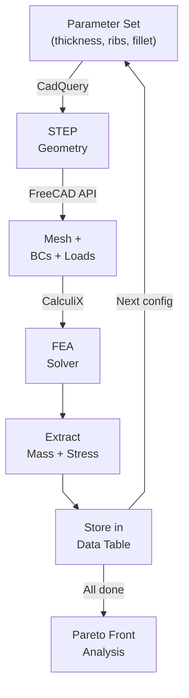

import TawkWidget from '../../../../components/TawkWidget.astro';
import UniversalContentContributors from '../../../../components/UniversalContentContributors.astro';
import InArticleAd from '../../../../components/InArticleAd.astro';
import Copyright from '../../../../components/Copyright.astro';
import BionicText from '../../../../components/BionicText.astro';
import TailwindWrapper from '../../../../components/TailwindWrapper.jsx';
import { Tabs, TabItem } from '@astrojs/starlight/components';
import { Card, CardGrid, Badge, Steps, LinkButton, FileTree } from '@astrojs/starlight/components';

<UniversalContentContributors 
  contributors={frontmatter.contributors}
/>


import CodeBasedMechanicalDesignComments from '../../../../components/code-based-mechanical-design/CodeBasedMechanicalDesignComments.astro';

A bracket that is too thin cracks at its corner. A bracket that is too thick wastes metal on every unit made. Finding the size between the two by hand means changing a dimension, running a stress analysis, writing down the result and starting again. With three dimensions and five values each, that is 125 runs, and most people stop after a dozen and accept the first design that holds. In this capstone a script does the 125 runs. CadQuery, a Python library that makes solid models from code, builds each bracket. Finite element analysis (FEA), which finds the stress in a part by cutting it into thousands of small pieces, checks each one. You then choose from a chart of mass against stress. #FEA #StructuralOptimization #Capstone

## Learning Objectives

By the end of this lesson, you will be able to:

1. Design a parametric L-bracket in CadQuery with configurable wall thickness, rib count, fillet radius, and mounting holes
2. Automate the CadQuery-to-STEP-to-FreeCAD pipeline using Python scripting
3. Configure FreeCAD FEM analysis: mesh generation, boundary conditions, loads, and CalculiX solver settings
4. Execute a systematic parameter sweep across a 3D design space (wall thickness, rib count, fillet radius)
5. Analyze results on a Pareto front to identify the optimal mass-vs-stress trade-off

## The Optimization Loop

<InArticleAd />


Three free programs work in a chain, and a Python script passes the files between them. FreeCAD is a CAD program whose FEM workbench prepares an analysis. CalculiX is the solver that computes the stresses. STEP is the file format that carries exact geometry from one program to the next.



<Steps>
1. **CadQuery generates geometry**: one bracket from three design variables (wall thickness $t$, rib count $n_r$, fillet radius $r_f$)

2. **Export to STEP**: the exact geometry is written to a file

3. **FreeCAD FEM imports and meshes**: a script adds the mesh, the material, the supports and the load

4. **CalculiX solves**: it computes displacements and stresses

5. **Python extracts results**: the highest stress from the results, and the mass from the volume

6. **Record and repeat**: store parameters, mass and stress, then take the next combination

7. **Pareto front analysis**: plot mass against stress for all designs and keep the best trade-offs
</Steps>

<Card title="The Driver Loop" icon="setting">
Steps 1 to 6 repeat for each of the 125 combinations of wall thickness, rib count and fillet radius. Step 7 runs once at the end.
</Card>

## Parametric Bracket Design in CadQuery

<InArticleAd />

The part is an L-bracket, the angle piece that holds a motor, a sensor or a shelf to a surface.

```text
     side view                     ┌───┐
                                   │   │  web (vertical plate)
           load hole  ──────────►  │ o │
                                   │   │
                                 ╱ │   │
           rib (triangle) ►    ╱   │   │
                             ╱     │   │
   ┌───────────────────────╱───────┘   │  a fillet rounds
   │   base plate, bolted down         │  this inside corner
   └───────────────────────────────────┘
```

- The base plate is bolted to a surface through four holes.
- The web carries the load at a hole near its top.
- A rib is a thin triangular wall that braces the corner, as a diagonal strut braces a shelf.
- A fillet is a rounded inside corner. A sharp inside corner concentrates stress and a rounded one spreads it.

### Design Parameters

<CardGrid>
  <Card title="Wall Thickness (t)" icon="setting">
    **Range: 2-6 mm.** The thickness of base and web. It moves mass and stress more than anything else.
  </Card>

  <Card title="Rib Count (n_r)" icon="setting">
    **Range: 0-4 ribs.** Each rib adds a little mass and braces the corner.
  </Card>

  <Card title="Fillet Radius (r_f)" icon="setting">
    **Range: 1-8 mm.** A larger radius lowers the stress in the corner, but it can get in the way of what is mounted there.
  </Card>

  <Card title="Fixed Parameters" icon="approve-check">
    **Base: 60x40 mm, Web height: 50 mm, Material: Aluminum 6061-T6.** These stay the same in every design.
  </Card>
</CardGrid>

<Tabs>
  <TabItem label="Bracket Design">

```python
import cadquery as cq
import numpy as np
from typing import Tuple

def parametric_bracket(
    base_width: float = 60.0,     # mm, base plate width (X)
    base_depth: float = 40.0,     # mm, base plate depth (Y)
    web_height: float = 50.0,     # mm, vertical web height (Z)
    wall_thickness: float = 4.0,  # mm, plate thickness
    fillet_radius: float = 4.0,   # mm, base-web junction fillet
    n_ribs: int = 2,              # number of stiffening ribs
    rib_thickness: float = None,  # mm, defaults to wall_thickness
    hole_diameter: float = 6.5,   # mm, mounting hole diameter (M6 clearance)
    hole_inset: float = 10.0,     # mm, hole center distance from edges
) -> cq.Workplane:
    """Generate a parametric L-bracket with ribs and fillets.

    The bracket sits at the origin with the base plate on the
    XY plane and the web extending upward along Z.

    Args:
        base_width: Width of the base plate (X direction)
        base_depth: Depth of the base plate (Y direction)
        web_height: Height of the vertical web (Z direction)
        wall_thickness: Thickness of plates
        fillet_radius: Fillet radius at base-web junction
        n_ribs: Number of triangular stiffening ribs
        rib_thickness: Rib thickness (defaults to wall_thickness)
        hole_diameter: Mounting hole diameter
        hole_inset: Distance from edge to hole center

    Returns:
        CadQuery solid of the bracket
    """
    t = wall_thickness
    if rib_thickness is None:
        rib_thickness = t

    # === Base plate ===
    base = (
        cq.Workplane("XY")
        .box(base_width, base_depth, t,
             centered=(True, True, False))
    )

    # === Vertical web ===
    # Web sits at the back edge of the base (Y = base_depth/2)
    web = (
        cq.Workplane("XY")
        .transformed(offset=(0, base_depth/2 - t/2, t))
        .box(base_width, t, web_height,
             centered=(True, True, False))
    )

    # Union base and web
    bracket = base.union(web)

    # === Fillet at base-web junction ===
    if fillet_radius > 0:
        # Select the interior edge where base meets web
        # Use NearestToPointSelector to target the concave junction edge
        try:
            bracket = (
                bracket
                .edges("|X")
                .edges(
                    cq.selectors.NearestToPointSelector(
                        (0, base_depth/2 - t, t)
                    )
                )
                .fillet(fillet_radius)
            )
        except Exception:
            pass  # Skip if fillet fails on complex geometry

    # === Stiffening ribs ===
    if n_ribs > 0:
        # Distribute ribs evenly across the width
        if n_ribs == 1:
            rib_positions = [0.0]
        else:
            margin = hole_inset + hole_diameter
            rib_span = base_width - 2 * margin
            rib_positions = np.linspace(
                -rib_span/2, rib_span/2, n_ribs
            ).tolist()

        rib_height = web_height * 0.7  # Ribs are 70% of web height
        rib_depth = base_depth * 0.6   # Ribs extend 60% of base depth

        for x_pos in rib_positions:
            # Triangular rib profile, drawn on the "YZ" workplane and
            # extruded along X. On this workplane the local axes are
            # (Y, Z, X), so the offset is given in that order: the corner
            # of the triangle sits where the web meets the base, and the
            # rib is centered on x_pos.
            rib = (
                cq.Workplane("YZ")
                .transformed(offset=(
                    base_depth/2 - t,
                    t,
                    x_pos - rib_thickness/2
                ))
                .moveTo(0, 0)
                .lineTo(-rib_depth, 0)
                .lineTo(0, rib_height)
                .close()
                .extrude(rib_thickness)
            )

            bracket = bracket.union(rib)

        # Fillet rib edges if radius permits
        if fillet_radius > 1:
            try:
                bracket = bracket.edges(
                    cq.selectors.BoxSelector(
                        (-base_width/2, -base_depth/2, t),
                        (base_width/2, base_depth/2, t + web_height)
                    )
                ).fillet(min(fillet_radius, rib_thickness * 0.4))
            except Exception:
                pass  # Skip if fillet fails on complex geometry

    # === Mounting holes in the base plate ===
    hole_positions = [
        (base_width/2 - hole_inset, base_depth/2 - hole_inset),
        (base_width/2 - hole_inset, -base_depth/2 + hole_inset),
        (-base_width/2 + hole_inset, base_depth/2 - hole_inset),
        (-base_width/2 + hole_inset, -base_depth/2 + hole_inset),
    ]

    for hx, hy in hole_positions:
        bracket = (
            bracket
            .faces("<Z")
            .workplane()
            .pushPoints([(hx, hy)])
            .hole(hole_diameter, t)
        )

    # === Load application hole in the web ===
    load_hole_z = t + web_height * 0.75  # 75% up the web
    bracket = (
        bracket
        .faces(">Y")
        .workplane()
        .pushPoints([(0, load_hole_z)])  # workplane origin is at Z = 0
        .hole(hole_diameter, t)
    )

    return bracket

# Generate a bracket with default parameters
bracket = parametric_bracket(
    wall_thickness=4.0,
    fillet_radius=4.0,
    n_ribs=2
)

# Export
cq.exporters.export(bracket, "bracket_t4_r2_f4.step")
```

  </TabItem>
  <TabItem label="Mass Calculation">

```python
import cadquery as cq

def bracket_mass(bracket: cq.Workplane,
                 density: float = 2.70e-6) -> float:
    """Calculate the mass of a bracket solid.

    Args:
        bracket: CadQuery solid
        density: Material density in kg/mm³
                 (Aluminum 6061: 2.70e-6 kg/mm³ = 2700 kg/m³)

    Returns:
        Mass in grams
    """
    # CadQuery volumes are in mm³
    volume_mm3 = bracket.val().Volume()
    mass_kg = volume_mm3 * density
    mass_g = mass_kg * 1000
    return mass_g

# Example
mass = bracket_mass(bracket)
print(f"Bracket volume: {bracket.val().Volume():.1f} mm³")
print(f"Bracket mass:   {mass:.2f} g")
```

  </TabItem>
  <TabItem label="Parameter Grid">

```python
import numpy as np
from itertools import product

def generate_parameter_space():
    """Define the 3D parameter sweep grid.

    Returns:
        List of (wall_thickness, n_ribs, fillet_radius) tuples
    """
    # Wall thickness: 2.0 to 6.0 mm in 1.0 mm steps
    thicknesses = [2.0, 3.0, 4.0, 5.0, 6.0]

    # Rib count: 0 to 4
    rib_counts = [0, 1, 2, 3, 4]

    # Fillet radius: 1.0 to 8.0 mm
    fillet_radii = [1.0, 2.0, 4.0, 6.0, 8.0]

    # Full factorial: 5 × 5 × 5 = 125 configurations
    space = list(product(thicknesses, rib_counts, fillet_radii))

    print(f"Parameter space: {len(space)} configurations")
    print(f"  Wall thickness: {thicknesses} mm")
    print(f"  Rib count:      {rib_counts}")
    print(f"  Fillet radius:  {fillet_radii} mm")

    return space

parameter_space = generate_parameter_space()
```

  </TabItem>
</Tabs>

## A hand estimate before the solver

A solver always prints a number. Whether it means anything depends on the load, the supports and the mesh you gave it. So estimate the stress by hand first, and when the solver disagrees by a factor of three, find out why.

Take a force $F$ that pushes sideways on the web, at a height $a$ above the base. The web bends like a diving board fixed at its root, and the bending stress there is:

$$
\sigma = \frac{6 F a}{b t^2}
$$

where $\sigma$ is the stress (MPa), $F$ the force (N), $a$ the height of the load above the base (mm), $b$ the width of the web (mm) and $t$ its thickness (mm). For this bracket $F = 500$ N, $a = 0.75 \times 50 = 37.5$ mm and $b = 60$ mm. With $t = 4$ mm:

$$
\sigma = \frac{6 \times 500 \times 37.5}{60 \times 4^2} = 117 \text{ MPa}
$$

The stress falls with the square of the thickness, while the mass grows only in proportion to it, about 14 g for each millimetre. That is the trade-off the sweep explores. The formula has no ribs, no fillet and no holes, and those are what the solver adds.

Direction matters. The scripts below apply the force along Z, in the plane of the web. That presses the web straight down onto the fixed base and nothing bends: the stress is near $F / (b t) = 2$ MPa, with a local peak at the load hole, and every design passes. To study bending, the case of the estimate above and of the sensitivity table later, apply the force along Y.

Three results a solver cannot be trusted for:

- The peak at a sharp inside corner. It keeps rising as the mesh gets finer and never settles. Give the corner a fillet.
- Anything above the yield strength, here 276 MPa. This analysis is linear: it assumes the metal springs back fully.
- The stress next to a support. The scripts fix the whole bottom face, which is stiffer than four real bolts.

## FreeCAD FEM Python API

<InArticleAd />

To set up an analysis you give the solver four things: a mesh (the part cut into small elements, here pyramids with four corners), a material, the supports, called boundary conditions, and the loads. The solver returns the displacement and the stress at every corner point (node) of the mesh. The stress is reported as the von Mises stress, one number that combines stresses in all directions so that it can be compared with the yield strength.

FreeCAD's FEM workbench can be driven from Python. The key objects are:

| FreeCAD Object | Purpose |
|---------------|---------|
| `FemAnalysis` | Container for all FEM objects |
| `Fem::FemMeshGmsh` | Gmsh mesh generation |
| `Fem::ConstraintFixed` | Fixed boundary condition (zero displacement) |
| `Fem::ConstraintForce` | Applied force load |
| `FemMaterial` | Material properties assignment |
| `Fem::FemSolverCalculix` | CalculiX solver configuration |

<Tabs>
  <TabItem label="FEM Setup">

```python
"""
FreeCAD FEM setup script.

Run this inside FreeCAD's Python console or via:
    freecad --console script.py

This script:
1. Imports a STEP file
2. Creates a FEM analysis
3. Assigns material properties
4. Creates mesh
5. Applies boundary conditions and loads
6. Solves with CalculiX
"""
import FreeCAD
import Part
import Fem
import ObjectsFem
import Mesh
import femmesh.femmesh2mesh

def setup_fem_analysis(
    step_file: str,
    output_dir: str,
    force_magnitude: float = 500.0,  # N
    mesh_size: float = 2.0,          # mm
) -> dict:
    """Set up and run a FEM analysis on an imported STEP bracket.

    Args:
        step_file: Path to the STEP file from CadQuery
        output_dir: Directory for solver output files
        force_magnitude: Applied force in Newtons
        mesh_size: Maximum mesh element size in mm

    Returns:
        Dictionary with analysis results
    """
    # --- Create new document ---
    doc = FreeCAD.newDocument("BracketFEM")

    # --- Import STEP geometry ---
    Part.insert(step_file, doc.Name)
    shape_obj = doc.Objects[0]
    doc.recompute()

    # --- Create FEM Analysis container ---
    analysis = ObjectsFem.makeAnalysis(doc, "Analysis")

    # --- Assign material: Aluminum 6061-T6 ---
    material = ObjectsFem.makeMaterialSolid(doc, "Aluminum6061T6")
    mat_dict = material.Material
    mat_dict["Name"] = "Aluminum 6061-T6"
    mat_dict["YoungsModulus"] = "68900 MPa"
    mat_dict["PoissonRatio"] = "0.33"
    mat_dict["Density"] = "2700 kg/m^3"
    mat_dict["ThermalExpansionCoefficient"] = "23.6 µm/m/K"
    mat_dict["YieldStrength"] = "276 MPa"
    mat_dict["UltimateTensileStrength"] = "310 MPa"
    material.Material = mat_dict
    analysis.addObject(material)

    # --- Create mesh with Gmsh ---
    femmesh = ObjectsFem.makeMeshGmsh(doc, "FEMMeshGmsh")
    femmesh.Part = shape_obj
    femmesh.CharacteristicLengthMax = mesh_size
    femmesh.CharacteristicLengthMin = mesh_size / 4
    femmesh.ElementOrder = "2nd"  # Quadratic elements
    femmesh.Algorithm2D = "Frontal"
    femmesh.Algorithm3D = "Delaunay"

    # Run Gmsh meshing
    from femmesh.gmshtools import GmshTools
    gmsh = GmshTools(femmesh)
    gmsh.create_mesh()

    analysis.addObject(femmesh)
    print(f"Mesh: {femmesh.FemMesh.NodeCount} nodes, "
          f"{femmesh.FemMesh.VolumeCount} elements")

    # --- Fixed constraint on base plate bottom face ---
    fixed = ObjectsFem.makeConstraintFixed(doc, "FixedBase")
    # Select the bottom face (Z = 0)
    bottom_faces = []
    for i, face in enumerate(shape_obj.Shape.Faces):
        com = face.CenterOfMass
        if abs(com.z) < 0.1:  # Bottom face
            bottom_faces.append(
                ("Face" + str(i + 1), face)
            )

    if bottom_faces:
        fixed.References = [
            (shape_obj, bottom_faces[0][0])
        ]
    analysis.addObject(fixed)

    # --- Force load on the web hole ---
    force = ObjectsFem.makeConstraintForce(doc, "AppliedForce")
    force.Force = force_magnitude  # Newtons

    # Select the cylindrical face of the load hole
    # (the hole near the top of the web)
    load_faces = []
    for i, face in enumerate(shape_obj.Shape.Faces):
        com = face.CenterOfMass
        # Load hole is at ~75% web height, on the far Y face
        if com.z > 30 and abs(com.y) > 15:
            # Radius 3.25 mm = the 6.5 mm load hole (this skips fillets)
            if (face.Surface.TypeId == "Part::GeomCylinder" and
                    abs(face.Surface.Radius - 3.25) < 0.01):
                load_faces.append(("Face" + str(i + 1), face))

    if load_faces:
        force.References = [
            (shape_obj, load_faces[0][0])
        ]
    # Direction: along the normal of the flat bottom face (the Z axis).
    # Check the arrow in the FreeCAD GUI and switch Reversed if it
    # does not point downward (-Z).
    if bottom_faces:
        force.Direction = (shape_obj, [bottom_faces[0][0]])
    force.Reversed = False
    analysis.addObject(force)

    # --- Solver: CalculiX ---
    solver = ObjectsFem.makeSolverCalculix(doc, "CalculiX")
    solver.WorkingDir = output_dir
    solver.AnalysisType = "static"
    solver.GeometricalNonlinearity = "linear"
    solver.MaterialNonlinearity = "linear"
    solver.EigenmodesCount = 0
    solver.IterationsMaximum = 2000
    analysis.addObject(solver)

    # --- Run solver ---
    doc.recompute()

    from femtools import ccxtools
    fea = ccxtools.FemToolsCcx(analysis, solver)
    fea.update_objects()
    fea.setup_working_dir()
    fea.setup_ccx()

    message = fea.check_prerequisites()
    if message:
        print(f"Prerequisites check: {message}")
        return {"error": message}

    fea.write_inp_file()
    fea.ccx_run()
    fea.load_results()

    doc.recompute()

    return doc, analysis, solver

# Example usage (inside FreeCAD):
# doc, analysis, solver = setup_fem_analysis(
#     "bracket_t4_r2_f4.step",
#     "/tmp/bracket_fem/",
#     force_magnitude=500.0,
#     mesh_size=2.0
# )
```

  </TabItem>
  <TabItem label="Result Extraction">

```python
"""
Extract results from CalculiX .frd output file.

The .frd file format contains nodal displacements, stresses,
and strains computed by CalculiX.
"""
import os
import re
import numpy as np

def extract_frd_results(frd_path: str) -> dict:
    """Parse a CalculiX .frd file to extract key results.

    Args:
        frd_path: Path to the .frd results file

    Returns:
        Dictionary with max_von_mises, max_displacement, etc.
    """
    if not os.path.exists(frd_path):
        raise FileNotFoundError(f"FRD file not found: {frd_path}")

    von_mises_stresses = []
    displacements = []

    # Parse the .frd file
    with open(frd_path, 'r') as f:
        lines = f.readlines()

    # State machine for parsing
    in_stress_block = False
    in_disp_block = False

    for i, line in enumerate(lines):
        # Each result block starts with a " -4" line that names it,
        # for example " -4  STRESS      6    1"
        # Detect stress results block
        if line.startswith(" -4") and "STRESS" in line:
            in_stress_block = True
            in_disp_block = False
            continue

        # Detect displacement block
        if line.startswith(" -4") and "DISP" in line:
            in_disp_block = True
            in_stress_block = False
            continue

        # Any other block (strain, forces, ...) ends the current one
        if line.startswith(" -4"):
            in_stress_block = False
            in_disp_block = False
            continue

        # End of block
        if line.startswith(" -3"):
            in_stress_block = False
            in_disp_block = False
            continue

        # Parse stress data (nodal von Mises)
        # The .frd file uses fixed-width columns: 3 characters for the
        # record key, 10 for the node number, then 12 for each value.
        # Negative values touch the value before them, so split() on
        # spaces would lose those lines.
        if in_stress_block and line.startswith(" -1"):
            parts = [line[13 + 12 * k: 25 + 12 * k] for k in range(6)]
            if all(p.strip() for p in parts):
                try:
                    # Columns: sxx, syy, szz, sxy, syz, szx
                    sxx = float(parts[0])
                    syy = float(parts[1])
                    szz = float(parts[2])
                    sxy = float(parts[3])
                    syz = float(parts[4])
                    sxz = float(parts[5])

                    # Von Mises stress calculation
                    vm = np.sqrt(0.5 * (
                        (sxx - syy)**2 +
                        (syy - szz)**2 +
                        (szz - sxx)**2 +
                        6 * (sxy**2 + syz**2 + sxz**2)
                    ))
                    von_mises_stresses.append(vm)
                except (ValueError, IndexError):
                    continue

        # Parse displacement data
        if in_disp_block and line.startswith(" -1"):
            parts = [line[13 + 12 * k: 25 + 12 * k] for k in range(3)]
            if all(p.strip() for p in parts):
                try:
                    dx = float(parts[0])
                    dy = float(parts[1])
                    dz = float(parts[2])
                    disp = np.sqrt(dx**2 + dy**2 + dz**2)
                    displacements.append(disp)
                except (ValueError, IndexError):
                    continue

    if not von_mises_stresses:
        return {"error": "No stress results found in .frd file"}

    results = {
        "max_von_mises_MPa": max(von_mises_stresses),
        "mean_von_mises_MPa": np.mean(von_mises_stresses),
        "max_displacement_mm": max(displacements) if displacements else 0,
        "n_stress_nodes": len(von_mises_stresses),
        "n_disp_nodes": len(displacements),
    }

    return results

# Alternative: Extract results from FreeCAD result object
def extract_freecad_results(doc) -> dict:
    """Extract results from FreeCAD FEM result objects.

    Args:
        doc: FreeCAD document with completed analysis

    Returns:
        Dictionary with stress and displacement results
    """
    # Find the result object
    result_obj = None
    for obj in doc.Objects:
        if hasattr(obj, "vonMises"):
            result_obj = obj
            break

    if result_obj is None:
        return {"error": "No result object found"}

    von_mises = np.array(result_obj.vonMises)
    # Displacement magnitude at each node (one value per node)
    displacements = np.array(result_obj.DisplacementLengths)

    return {
        "max_von_mises_MPa": float(np.max(von_mises)),
        "mean_von_mises_MPa": float(np.mean(von_mises)),
        "p95_von_mises_MPa": float(np.percentile(von_mises, 95)),
        "max_displacement_mm": float(np.max(displacements)),
        "n_nodes": len(von_mises),
    }
```

  </TabItem>
  <TabItem label="Material Properties">

Aluminum 6061-T6 properties used throughout this analysis:

```python
# Material: Aluminum 6061-T6
AL_6061_T6 = {
    "name": "Aluminum 6061-T6",
    "E_MPa": 68_900,           # Young's modulus
    "nu": 0.33,                # Poisson's ratio
    "rho_kg_m3": 2_700,        # Density
    "sigma_y_MPa": 276,        # Yield strength (0.2% offset)
    "sigma_ult_MPa": 310,      # Ultimate tensile strength
    "fatigue_limit_MPa": 96,   # Endurance limit at 5×10^8 cycles
    "alpha_per_C": 23.6e-6,    # Thermal expansion coefficient
}

# Design constraints for this optimization
DESIGN_CONSTRAINTS = {
    "max_von_mises_MPa": 276 / 2.0,  # σ_y / safety factor 2.0
    "max_displacement_mm": 0.5,        # Stiffness requirement
    "applied_force_N": 500,            # Load case
    "force_direction": (0, 0, -1),     # Downward (-Z)
}

print(f"Allowable stress: {DESIGN_CONSTRAINTS['max_von_mises_MPa']:.0f} MPa")
print(f"Maximum deflection: {DESIGN_CONSTRAINTS['max_displacement_mm']} mm")
```

  </TabItem>
</Tabs>

## Automated Optimization Loop

<InArticleAd />


The driver script runs the whole chain once for each design. For each one it builds the bracket and computes its mass, writes a small FreeCAD script, starts FreeCAD as a separate program to mesh and solve, and reads the highest von Mises stress from a results file. A run that fails or takes more than five minutes is recorded and skipped, so one bad shape does not stop the sweep.

```python
"""
Automated FEA optimization loop.

This script runs outside FreeCAD, calling it as a subprocess
for each FEM analysis. This approach is more robust than running
everything inside a single FreeCAD session (which can leak memory
over hundreds of iterations).
"""
import os
import json
import subprocess
import time
import numpy as np
from itertools import product
from typing import List, Dict, Tuple

# === Configuration ===
WORK_DIR = "/tmp/bracket_optimization/"
FREECAD_PATH = "freecadcmd"  # FreeCAD command-line executable
FORCE_N = 500.0
MESH_SIZE = 2.0  # mm

# === Parameter space ===
THICKNESSES = [2.0, 3.0, 4.0, 5.0, 6.0]
RIB_COUNTS = [0, 1, 2, 3, 4]
FILLET_RADII = [1.0, 2.0, 4.0, 6.0, 8.0]

def generate_and_export_bracket(
    t: float, n_ribs: int, r_f: float, output_dir: str
) -> Tuple[str, float]:
    """Generate a bracket and export to STEP.

    Returns:
        (step_file_path, mass_grams)
    """
    import cadquery as cq

    bracket = parametric_bracket(
        wall_thickness=t,
        fillet_radius=r_f,
        n_ribs=n_ribs,
    )

    # Calculate mass
    volume_mm3 = bracket.val().Volume()
    mass_g = volume_mm3 * 2.70e-6 * 1000  # Al 6061 density

    # Export STEP
    step_path = os.path.join(output_dir, "bracket.step")
    cq.exporters.export(bracket, step_path)

    return step_path, mass_g

def write_fem_script(
    step_path: str, output_dir: str,
    force_n: float, mesh_size: float
) -> str:
    """Write a FreeCAD Python script for FEM analysis.

    Returns the path to the generated script.
    """
    script_content = f'''
import sys
import os
import json

# Add FreeCAD paths
import FreeCAD
import Part
import Fem
import ObjectsFem

# --- Configuration ---
STEP_FILE = "{step_path}"
OUTPUT_DIR = "{output_dir}"
FORCE_N = {force_n}
MESH_SIZE = {mesh_size}
RESULTS_FILE = os.path.join(OUTPUT_DIR, "results.json")

try:
    # Create document
    doc = FreeCAD.newDocument("BracketFEM")

    # Import geometry
    Part.insert(STEP_FILE, doc.Name)
    shape = doc.Objects[0]
    doc.recompute()

    # Create analysis
    analysis = ObjectsFem.makeAnalysis(doc, "Analysis")

    # Material
    material = ObjectsFem.makeMaterialSolid(doc, "Al6061T6")
    mat = material.Material
    mat["Name"] = "Aluminum 6061-T6"
    mat["YoungsModulus"] = "68900 MPa"
    mat["PoissonRatio"] = "0.33"
    mat["Density"] = "2700 kg/m^3"
    material.Material = mat
    analysis.addObject(material)

    # Mesh
    femmesh = ObjectsFem.makeMeshGmsh(doc, "FEMMesh")
    femmesh.Part = shape
    femmesh.CharacteristicLengthMax = MESH_SIZE
    femmesh.CharacteristicLengthMin = MESH_SIZE / 4
    femmesh.ElementOrder = "2nd"

    from femmesh.gmshtools import GmshTools
    gmsh_tools = GmshTools(femmesh)
    gmsh_tools.create_mesh()
    analysis.addObject(femmesh)

    # Fixed constraint (bottom face)
    fixed = ObjectsFem.makeConstraintFixed(doc, "Fixed")
    for i, face in enumerate(shape.Shape.Faces):
        if abs(face.CenterOfMass.z) < 0.1:
            bottom_face = "Face" + str(i+1)
            fixed.References = [(shape, bottom_face)]
            break
    analysis.addObject(fixed)

    # Force on web hole
    force = ObjectsFem.makeConstraintForce(doc, "Force")
    force.Force = FORCE_N
    for i, face in enumerate(shape.Shape.Faces):
        com = face.CenterOfMass
        if (com.z > 30 and
            hasattr(face.Surface, 'TypeId') and
            'Cylinder' in str(face.Surface) and
            abs(face.Surface.Radius - 3.25) < 0.01):
            force.References = [(shape, "Face" + str(i+1))]
            break
    # Force along the normal of the bottom face (the Z axis)
    force.Direction = (shape, [bottom_face])
    analysis.addObject(force)

    # Solver
    solver = ObjectsFem.makeSolverCalculix(doc, "Solver")
    solver.WorkingDir = OUTPUT_DIR
    solver.AnalysisType = "static"
    solver.GeometricalNonlinearity = "linear"
    analysis.addObject(solver)

    doc.recompute()

    # Run solver
    from femtools import ccxtools
    fea = ccxtools.FemToolsCcx(analysis, solver)
    fea.update_objects()
    fea.setup_working_dir()
    fea.setup_ccx()
    msg = fea.check_prerequisites()
    if not msg:
        fea.write_inp_file()
        fea.ccx_run()
        fea.load_results()
        doc.recompute()

        # Extract results
        import numpy as np_fc
        result_obj = None
        for obj in doc.Objects:
            if hasattr(obj, "vonMises"):
                result_obj = obj
                break

        if result_obj:
            vm = list(result_obj.vonMises)
            results = {{
                "max_von_mises_MPa": max(vm),
                "mean_von_mises_MPa": sum(vm)/len(vm),
                "n_nodes": len(vm),
                "status": "success"
            }}
        else:
            results = {{"status": "no_results"}}
    else:
        results = {{"status": "prereq_fail", "message": msg}}

except Exception as e:
    results = {{"status": "error", "message": str(e)}}

# Write results
with open(RESULTS_FILE, 'w') as f:
    json.dump(results, f, indent=2)

FreeCAD.closeDocument(doc.Name)
'''

    script_path = os.path.join(output_dir, "fem_script.py")
    with open(script_path, 'w') as f:
        f.write(script_content)

    return script_path

def run_single_analysis(
    t: float, n_ribs: int, r_f: float
) -> Dict:
    """Run one complete generate → mesh → solve cycle.

    Returns:
        Dictionary with parameters and results
    """
    # Create output directory for this configuration
    config_name = f"t{t:.0f}_r{n_ribs}_f{r_f:.0f}"
    config_dir = os.path.join(WORK_DIR, config_name)
    os.makedirs(config_dir, exist_ok=True)

    # Step 1: Generate geometry and export STEP
    step_path, mass_g = generate_and_export_bracket(
        t, n_ribs, r_f, config_dir
    )

    # Step 2: Write FEM script
    script_path = write_fem_script(
        step_path, config_dir, FORCE_N, MESH_SIZE
    )

    # Step 3: Run FreeCAD as subprocess
    try:
        result = subprocess.run(
            [FREECAD_PATH, "--console", script_path],
            capture_output=True, text=True,
            timeout=300,  # 5 minute timeout per analysis
        )
    except subprocess.TimeoutExpired:
        return {
            "t": t, "n_ribs": n_ribs, "r_f": r_f,
            "mass_g": mass_g,
            "status": "timeout"
        }

    # Step 4: Read results
    results_path = os.path.join(config_dir, "results.json")
    if os.path.exists(results_path):
        with open(results_path, 'r') as f:
            fem_results = json.load(f)
    else:
        fem_results = {"status": "no_output"}

    return {
        "t": t,
        "n_ribs": n_ribs,
        "r_f": r_f,
        "mass_g": mass_g,
        **fem_results,
    }

def run_optimization():
    """Execute the full parameter sweep."""
    os.makedirs(WORK_DIR, exist_ok=True)

    all_results = []
    total = len(THICKNESSES) * len(RIB_COUNTS) * len(FILLET_RADII)

    print(f"Starting optimization: {total} configurations")
    print("=" * 60)

    for i, (t, n_r, r_f) in enumerate(
        product(THICKNESSES, RIB_COUNTS, FILLET_RADII)
    ):
        print(f"[{i+1}/{total}] t={t}mm, ribs={n_r}, "
              f"fillet={r_f}mm ... ", end="", flush=True)

        start = time.time()
        result = run_single_analysis(t, n_r, r_f)
        elapsed = time.time() - start

        status = result.get("status", "unknown")
        if status == "success":
            sigma = result["max_von_mises_MPa"]
            print(f"OK ({elapsed:.1f}s): "
                  f"mass={result['mass_g']:.1f}g, "
                  f"σ_max={sigma:.1f} MPa")
        else:
            print(f"FAILED ({status})")

        all_results.append(result)

    # Save all results
    output_path = os.path.join(WORK_DIR, "all_results.json")
    with open(output_path, 'w') as f:
        json.dump(all_results, f, indent=2)

    print(f"\nResults saved to: {output_path}")
    return all_results

# Run the optimization
# all_results = run_optimization()
```

:::tip[Practical Runtime]
With a 2 mm mesh each analysis takes 1 to 2 minutes on a laptop, so 125 designs take 2 to 4 hours. While you develop the scripts, use 3 values per dimension (27 designs, about 30 minutes) or a mesh of 3 to 4 mm.
:::

## Pareto Front Analysis

<InArticleAd />


The sweep gives 125 designs, each with a mass and a stress, and we want both low. Most can be thrown away without judgment: if another design is lighter and also less stressed, nobody would choose the worse one. The designs that survive form the Pareto front, where less mass always costs more stress.

### Pareto Optimality

A design $A$ dominates a design $B$ when $A$ is lighter than $B$ and its highest stress is no greater:

$$
\text{Design } A \succ B \iff m_A < m_B \text{ and } \sigma_A \leq \sigma_B
$$

where $m$ is the mass (g) and $\sigma$ the highest von Mises stress (MPa). A design is Pareto-optimal when no other design dominates it.

The code finds the front by comparing every pair. `select_best_design` then keeps the front designs under the stress limit of 138 MPa and returns the lightest. It does not check the 0.5 mm deflection limit.

<Tabs>
  <TabItem label="Pareto Computation">

```python
import numpy as np
from typing import List, Dict, Tuple

def find_pareto_front(
    results: List[Dict],
    obj1_key: str = "mass_g",
    obj2_key: str = "max_von_mises_MPa",
    minimize_both: bool = True,
) -> List[int]:
    """Identify Pareto-optimal designs from a set of results.

    Args:
        results: List of result dictionaries
        obj1_key: Key for objective 1 (mass)
        obj2_key: Key for objective 2 (stress)
        minimize_both: Whether both objectives should be minimized

    Returns:
        List of indices into 'results' that are Pareto-optimal
    """
    # Filter to successful results only
    valid = [
        (i, r) for i, r in enumerate(results)
        if r.get("status") == "success"
    ]

    if not valid:
        return []

    n = len(valid)
    is_dominated = [False] * n

    for i in range(n):
        if is_dominated[i]:
            continue
        idx_i, ri = valid[i]
        m_i = ri[obj1_key]
        s_i = ri[obj2_key]

        for j in range(n):
            if i == j or is_dominated[j]:
                continue
            idx_j, rj = valid[j]
            m_j = rj[obj1_key]
            s_j = rj[obj2_key]

            # Does j dominate i?
            if minimize_both:
                if m_j <= m_i and s_j <= s_i and (
                    m_j < m_i or s_j < s_i
                ):
                    is_dominated[i] = True
                    break

    pareto_indices = [
        valid[i][0] for i in range(n) if not is_dominated[i]
    ]

    return pareto_indices

def select_best_design(
    results: List[Dict],
    pareto_indices: List[int],
    max_stress_MPa: float = 138.0,  # σ_y / 2.0
    max_displacement_mm: float = 0.5,
) -> int:
    """Select the best design from the Pareto front.

    Strategy: among Pareto-optimal designs that meet all
    constraints, select the one with minimum mass.

    Args:
        results: All results
        pareto_indices: Indices of Pareto-optimal designs
        max_stress_MPa: Maximum allowable stress
        max_displacement_mm: Maximum allowable displacement

    Returns:
        Index of the best design
    """
    feasible = []
    for idx in pareto_indices:
        r = results[idx]
        if r["max_von_mises_MPa"] <= max_stress_MPa:
            feasible.append(idx)

    if not feasible:
        print("WARNING: No Pareto-optimal design meets all "
              "constraints. Returning lowest-stress design.")
        return min(pareto_indices,
                   key=lambda i: results[i]["max_von_mises_MPa"])

    # Among feasible Pareto designs, pick lightest
    best = min(feasible, key=lambda i: results[i]["mass_g"])
    return best
```

  </TabItem>
  <TabItem label="Visualization">

```python
import matplotlib.pyplot as plt
import matplotlib.patches as mpatches
import numpy as np

def plot_pareto_front(
    results: List[Dict],
    pareto_indices: List[int],
    best_index: int = None,
    constraint_stress: float = 138.0,
    title: str = "Bracket Optimization: Mass vs. Max Stress"
):
    """Plot the Pareto front with all design points.

    Args:
        results: All result dictionaries
        pareto_indices: Indices of Pareto-optimal designs
        best_index: Index of the selected best design
        constraint_stress: Maximum allowable stress line
    """
    fig, ax = plt.subplots(1, 1, figsize=(10, 7))

    # Separate valid results
    valid = [
        (i, r) for i, r in enumerate(results)
        if r.get("status") == "success"
    ]

    masses = [r["mass_g"] for _, r in valid]
    stresses = [r["max_von_mises_MPa"] for _, r in valid]
    indices = [i for i, _ in valid]

    # Color by rib count for insight
    rib_counts = [r["n_ribs"] for _, r in valid]
    scatter = ax.scatter(
        masses, stresses,
        c=rib_counts, cmap='viridis',
        s=40, alpha=0.5, edgecolors='gray',
        linewidth=0.5, zorder=2
    )
    cbar = plt.colorbar(scatter, ax=ax, label='Rib Count')

    # Highlight Pareto front
    pareto_masses = [results[i]["mass_g"] for i in pareto_indices]
    pareto_stresses = [
        results[i]["max_von_mises_MPa"] for i in pareto_indices
    ]

    # Sort Pareto points by mass for a clean line
    pareto_sorted = sorted(
        zip(pareto_masses, pareto_stresses)
    )
    pm_sorted = [p[0] for p in pareto_sorted]
    ps_sorted = [p[1] for p in pareto_sorted]

    ax.plot(pm_sorted, ps_sorted, 'r-o',
            markersize=8, linewidth=2,
            label='Pareto front', zorder=3)

    # Highlight best design
    if best_index is not None:
        bm = results[best_index]["mass_g"]
        bs = results[best_index]["max_von_mises_MPa"]
        ax.plot(bm, bs, 'r*', markersize=20, zorder=5)
        ax.annotate(
            f'BEST DESIGN\n'
            f't={results[best_index]["t"]}mm, '
            f'ribs={results[best_index]["n_ribs"]}, '
            f'fillet={results[best_index]["r_f"]}mm\n'
            f'mass={bm:.1f}g, σ={bs:.0f} MPa',
            xy=(bm, bs),
            xytext=(bm + 5, bs + 20),
            fontsize=9,
            arrowprops=dict(arrowstyle='->', color='red',
                            linewidth=2),
            bbox=dict(boxstyle='round,pad=0.4',
                      facecolor='lightyellow',
                      edgecolor='red', alpha=0.9),
            zorder=6
        )

    # Constraint line
    ax.axhline(y=constraint_stress, color='orange',
               linestyle='--', linewidth=1.5,
               label=f'Stress limit ({constraint_stress} MPa)')

    # Feasible region shading
    ax.axhspan(0, constraint_stress, alpha=0.05,
               color='green', label='Feasible region')

    # Labels and formatting
    ax.set_xlabel('Mass (g)', fontsize=13)
    ax.set_ylabel('Max von Mises Stress (MPa)', fontsize=13)
    ax.set_title(title, fontsize=14, fontweight='bold')
    ax.legend(loc='upper right', fontsize=10)
    ax.grid(True, alpha=0.3)

    # Add design direction arrows
    ax.annotate('', xy=(min(masses)*0.95, min(stresses)*0.9),
                xytext=(max(masses)*0.5, max(stresses)*0.5),
                arrowprops=dict(arrowstyle='->',
                                color='green', linewidth=2))
    ax.text(min(masses)*1.05, min(stresses)*0.95,
            'Ideal\ndirection',
            fontsize=9, color='green', style='italic')

    plt.tight_layout()
    plt.savefig("pareto_front.png", dpi=150, bbox_inches='tight')
    plt.show()

    return fig

# Usage:
# pareto_idx = find_pareto_front(all_results)
# best_idx = select_best_design(all_results, pareto_idx)
# plot_pareto_front(all_results, pareto_idx, best_idx)
```

  </TabItem>
  <TabItem label="Results Table">

```python
import pandas as pd

def results_summary_table(
    results: List[Dict],
    pareto_indices: List[int],
    best_index: int
) -> pd.DataFrame:
    """Create a summary table of all valid results.

    Highlights Pareto-optimal and best designs.
    """
    rows = []
    for i, r in enumerate(results):
        if r.get("status") != "success":
            continue
        rows.append({
            "Config #": i,
            "t (mm)": r["t"],
            "Ribs": r["n_ribs"],
            "Fillet (mm)": r["r_f"],
            "Mass (g)": round(r["mass_g"], 1),
            "σ_max (MPa)": round(r["max_von_mises_MPa"], 1),
            "Pareto?": "Yes" if i in pareto_indices else "",
            "Best?": ">>> BEST <<<" if i == best_index else "",
        })

    df = pd.DataFrame(rows)

    # Sort by mass
    df = df.sort_values("Mass (g)").reset_index(drop=True)

    return df

# Usage:
# df = results_summary_table(all_results, pareto_idx, best_idx)
# print(df.to_string())
# df.to_csv("optimization_results.csv", index=False)
```

  </TabItem>
</Tabs>

## Interpreting the Pareto Front

<InArticleAd />


The plot has mass on the horizontal axis and stress on the vertical axis. Read it in five steps:

<Steps>
1. **Left end of the front**: light designs with high stress. Thin walls, no ribs, small fillets.

2. **Right end of the front**: heavy designs with low stress. Thick walls, many ribs, large fillets.

3. **The knee**: the bend in the front, where each added gram starts to buy much less stress. Good designs are often near it.

4. **Above the limit line**: designs that fail the strength check, whatever their mass.

5. **Below the line but off the front**: dominated designs. Another design is both lighter and less stressed.
</Steps>

### Design Sensitivity Insights

The sweep also shows which dimension matters most. The function below draws, for each value of each parameter, a box plot: a box that spans the middle half of the results, with a line at the median.

```python
import matplotlib.pyplot as plt
import numpy as np

def sensitivity_analysis(results: List[Dict]):
    """Analyze how each parameter affects mass and stress.

    Creates box plots showing the distribution of stress
    for each value of each design parameter.
    """
    valid = [r for r in results if r.get("status") == "success"]

    fig, axes = plt.subplots(2, 3, figsize=(14, 8))

    params = [
        ("t", "Wall Thickness (mm)", [2, 3, 4, 5, 6]),
        ("n_ribs", "Rib Count", [0, 1, 2, 3, 4]),
        ("r_f", "Fillet Radius (mm)", [1, 2, 4, 6, 8]),
    ]

    for col, (key, label, values) in enumerate(params):
        # Stress sensitivity
        stress_data = []
        for v in values:
            stresses = [
                r["max_von_mises_MPa"] for r in valid
                if r[key] == v
            ]
            stress_data.append(stresses)

        axes[0, col].boxplot(stress_data, labels=values)
        axes[0, col].set_xlabel(label)
        axes[0, col].set_ylabel("Max σ_vM (MPa)")
        axes[0, col].set_title(f"Stress vs. {label}")
        axes[0, col].grid(True, alpha=0.3)

        # Mass sensitivity
        mass_data = []
        for v in values:
            masses = [
                r["mass_g"] for r in valid
                if r[key] == v
            ]
            mass_data.append(masses)

        axes[1, col].boxplot(mass_data, labels=values)
        axes[1, col].set_xlabel(label)
        axes[1, col].set_ylabel("Mass (g)")
        axes[1, col].set_title(f"Mass vs. {label}")
        axes[1, col].grid(True, alpha=0.3)

    plt.suptitle("Parameter Sensitivity Analysis", fontsize=14,
                 fontweight='bold')
    plt.tight_layout()
    plt.savefig("sensitivity_analysis.png", dpi=150)
    plt.show()

# sensitivity_analysis(all_results)
```

What to expect for an L-bracket whose web is bent by the load. These are trends from the mechanics, not printed results of a run:

| Parameter | Effect on Stress | Effect on Mass | Sensitivity |
|-----------|-----------------|----------------|-------------|
| Wall thickness $t$ | Strong reduction (inverse square) | Strong increase (linear) | **Highest** |
| Rib count $n_r$ | Moderate reduction (ribs brace the junction) | Small increase per rib | **Medium** |
| Fillet radius $r_f$ | Moderate reduction (stress concentration relief) | Negligible increase | **Medium** (stress only) |

:::note[Key Insight]
Wall thickness moves both mass and stress most. A fillet is almost free: it lowers the stress and adds very little mass. Ribs lower the stress at a moderate cost in mass. A usual order of work: make the fillet as large as fits, add one or two ribs, then find the thinnest wall that meets the stress limit.
:::

## Complete Capstone Workflow

<InArticleAd />


The whole sequence, in order:

<Steps>
1. **Set up the environment**
   ```bash
   pip install cadquery numpy scipy matplotlib pandas
   # Ensure FreeCAD is installed with FEM workbench
   # Ensure CalculiX (ccx) is on the system PATH
   which ccx  # Should return the CalculiX solver path
   ```

2. **Define the parametric bracket** in CadQuery (code above) and test with a single configuration

3. **Verify FEM setup** by running a single analysis manually in FreeCAD to confirm mesh quality, boundary conditions, and load application are correct

4. **Run the parameter sweep**: start with a coarse grid (3 values per parameter = 27 configurations) to verify the pipeline, then expand to the full grid (125 configurations)

5. **Compute the Pareto front** and generate the visualization

6. **Select the optimal design** from the Pareto front and regenerate the final bracket in CadQuery

7. **Final verification**: run one last FEM analysis at finer mesh size (1mm) to confirm the stress result converges

8. **Export production files**: STEP for CNC machining, STL for 3D printing
</Steps>

### Final Design Export

```python
def export_final_design(
    results: List[Dict],
    best_index: int,
    output_dir: str = "./final_bracket/"
):
    """Generate and export the final optimized bracket.

    Creates STEP, STL, and a design report.
    """
    import cadquery as cq
    import json
    import os

    os.makedirs(output_dir, exist_ok=True)
    r = results[best_index]

    # Regenerate the optimal bracket
    bracket = parametric_bracket(
        wall_thickness=r["t"],
        fillet_radius=r["r_f"],
        n_ribs=r["n_ribs"],
    )

    # Export geometry
    step_path = os.path.join(output_dir, "bracket_optimized.step")
    stl_path = os.path.join(output_dir, "bracket_optimized.stl")
    cq.exporters.export(bracket, step_path)
    cq.exporters.export(bracket, stl_path)

    # Design report
    report = {
        "project": "L-Bracket Structural Optimization",
        "material": "Aluminum 6061-T6",
        "design_parameters": {
            "wall_thickness_mm": r["t"],
            "rib_count": r["n_ribs"],
            "fillet_radius_mm": r["r_f"],
        },
        "performance": {
            "mass_g": round(r["mass_g"], 2),
            "max_von_mises_stress_MPa": round(
                r["max_von_mises_MPa"], 1
            ),
            "allowable_stress_MPa": 138.0,
            "safety_factor": round(
                138.0 / r["max_von_mises_MPa"], 2
            ),
        },
        "load_case": {
            "applied_force_N": 500,
            "direction": "Downward (-Z) on web hole",
            "boundary_condition": "Fixed base plate (4 bolt holes)",
        },
        "optimization": {
            "total_configurations_evaluated": len(results),
            "pareto_optimal_count": len([
                i for i in range(len(results))
                if i in find_pareto_front(results)
            ]),
            "solver": "CalculiX",
            "mesh_type": "2nd order tetrahedral",
        },
        "files": {
            "step": os.path.basename(step_path),
            "stl": os.path.basename(stl_path),
        }
    }

    report_path = os.path.join(output_dir, "design_report.json")
    with open(report_path, 'w') as f:
        json.dump(report, f, indent=2)

    print(f"\n{'='*50}")
    print(f"FINAL OPTIMIZED BRACKET")
    print(f"{'='*50}")
    print(f"Wall thickness:  {r['t']} mm")
    print(f"Rib count:       {r['n_ribs']}")
    print(f"Fillet radius:   {r['r_f']} mm")
    print(f"Mass:            {r['mass_g']:.1f} g")
    print(f"Max stress:      {r['max_von_mises_MPa']:.1f} MPa")
    print(f"Safety factor:   "
          f"{138.0 / r['max_von_mises_MPa']:.2f}")
    print(f"{'='*50}")
    print(f"STEP: {step_path}")
    print(f"STL:  {stl_path}")
    print(f"Report: {report_path}")

    return bracket

# Export the final design
# final_bracket = export_final_design(all_results, best_idx)
```

## Course Summary: What You Have Built

<InArticleAd />


The capstone reuses one idea from each earlier lesson:

<CardGrid>
  <Card title="Hardware library" icon="setting">
    Functions that build geometry from tables and equations. The bracket function is one of them.
  </Card>

  <Card title="Involute gears" icon="setting">
    Engineering mathematics turned into geometry, with a stress formula as the check.
  </Card>

  <Card title="PCB enclosures" icon="setting">
    Geometry driven by data read from a file. Here the loop reads solver results the same way.
  </Card>

  <Card title="Heat sinks" icon="setting">
    A sweep over a grid of designs, then a choice within limits. This lesson adds a solver inside the sweep.
  </Card>

  <Card title="Lattice structures" icon="setting">
    Shapes computed with NumPy, beyond what is practical to draw by hand.
  </Card>

  <Card title="Spring design" icon="setting">
    A stress check against a limit with a safety factor, done before the part is made.
  </Card>
</CardGrid>

## Key Takeaways

<InArticleAd />


<CardGrid>
  <Card title="The script does the repetition" icon="rocket">
    125 runs by hand take weeks. The loop finishes them in a few hours with nobody at the keyboard.
  </Card>

  <Card title="A front, not one answer" icon="approve-check">
    The Pareto front shows what each gram buys in stress. The limit then picks the design.
  </Card>

  <Card title="The design is in the scripts" icon="setting">
    Geometry, loads, supports and solver settings are all text, so anyone can run the study again and check it.
  </Card>

  <Card title="Check one run by hand first" icon="warning">
    A wrong load direction runs silently through all 125 designs. Compare one result with a hand estimate before you start the sweep.
  </Card>
</CardGrid>

:::tip[Next Steps]
A full grid stops being practical above about five design variables: five values each already give 3,125 runs. Methods that need fewer runs:
- Latin hypercube sampling spreads a small number of designs evenly through the space.
- Bayesian optimization (for example with `scikit-optimize`) fits a simple model to the results so far and uses it to pick the next design.
- Genetic algorithms (for example with `pymoo`) breed new designs from the best ones.
- Topology optimization lets the solver decide where material is needed.
:::

<CodeBasedMechanicalDesignComments />


<InArticleAd />
<TawkWidget />
<Copyright />